# HuddleUp: Study Circle LAN Chat

Repository: https://github.com/hyerone1/ITAS-2B-SD-Lucendo-Galos

> ITAS1 Final Project, Network Programming | Java LAN Chat Application | By Pair

## 1. Project Overview

**HuddleUp** is a Java LAN chat application for classmates who review for exams together. It has a multi-threaded TCP server and Swing graphical clients. Besides normal group chat, it has a **shared Question Queue** and a **Live Poll**, so a study group can decide what to review next together.

- Language: Java (Swing GUI, `java.net.Socket` / `ServerSocket`)
- No database, no internet hosting. All data is kept in memory for the running session.

## 2. Members

| Member | GitHub username | Main responsibility |
|---|---|---|
| Lucendo | [@hyerone1](https://github.com/hyerone1) | Server, concurrency, protocol |
| Galos | [@eryllegalos15-glitch](https://github.com/eryllegalos15-glitch) | Client GUI, Question Queue / Poll panels |

- **Course and section:** BSIT-2B-SD
- **Instructor:** Kenth Joshua Espina

## 3. Concept Proposal and Approval

| Item | Details |
|---|---|
| Theme | Study Circle |
| Target users | Classmates reviewing a subject together |
| User problem | In an ordinary group chat, questions get buried and nobody knows which ones are still unanswered or what the group wants to review. |
| Original feature 1 | **Shared Question Queue**: anyone can post a question, everyone can upvote it, and anyone can mark it answered or reopen it. The list is sorted by open status and votes, and is the same on every client. |
| Original feature 2 | **Live Poll**: any member starts a poll with 2 to 5 options (or turns a queued question into a poll), everyone votes, and results update live on all clients. Ending a poll announces the winner or tie. |
| Sample screens | See [Screenshots](#10-screenshots) |

**Instructor approval:** ☐ Pending instructor approval 

## 4. Features

### Core features
- Multi-threaded server: one handler thread per client, with a separate writer thread and outbox queue per client
- 3 or more simultaneous clients; one client disconnecting does not stop the server or other clients
- Configurable server IP and port in the GUI, with input validation
- Group chat: each message is broadcast once to every client, including the sender, with nickname and time
- Online user list, updated on join, leave and rename
- Unique, non-blank nicknames (1 to 16 letters, digits, `_` or `-`; case-insensitive uniqueness)
- Commands: `/name <newname>`, `/exit`, `/help`
- Blank-message rejection, unavailable-server and lost-connection errors, clean resource release
- Chat history is kept in the conversation area during the session (the server also replays the last 50 messages to late joiners)

### Original theme features
1. **Question Queue**: add, upvote (toggle), mark answered or reopen
2. **Live Poll**: start, vote (one vote per person, changeable), end with announced result, or start a poll from a queued question (the question is marked answered when the poll ends)

## 5. Architecture

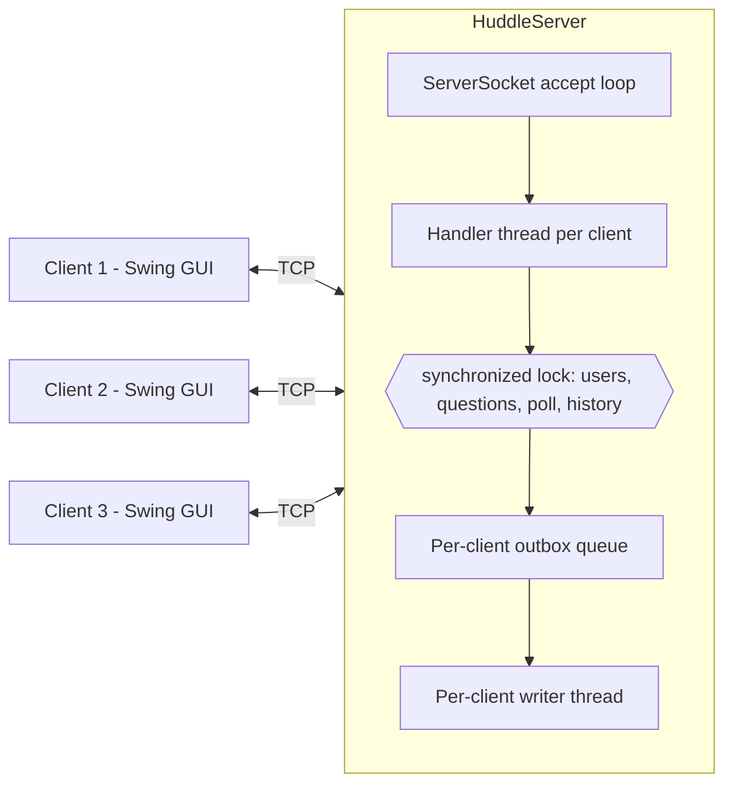

**Message path (client to server to recipients):**
1. The user types a message and clicks Send. The GUI sends `MSG|text` through a dedicated network-writer thread, so the GUI never blocks.
2. The server's `Handler` thread for that client reads the line and validates it (blank, length, command) inside `synchronized(lock)`.
3. The server builds `CHAT|time|nick|text`, stores it in history, and puts it in **every** client's outbox queue.
4. Each client's writer thread sends its queued lines in order, so messages from different senders never mix.
5. Each client's reader thread receives the line and hands it to the **Event Dispatch Thread** with `SwingUtilities.invokeLater`, which updates the conversation area.

**Concurrency design**
- All shared state is touched only inside `synchronized(lock)`.
- Sending never blocks the lock (`outbox.offer`). A client that stops reading (more than 2000 queued lines) is dropped.
- A handshake timeout of 15 seconds prevents idle sockets that never send `NICK`.

## 6. Message Format

Every message is one UTF-8 text line: `TYPE|payload`. The `|` and `;` characters are stripped from questions, poll text and options.

**Client to server**

| Message | Meaning |
|---|---|
| `NICK\|name` | First line after connecting; requests a nickname |
| `MSG\|text` | Chat message, or a command if it starts with `/` |
| `Q_ADD\|text` | Add a question |
| `Q_VOTE\|id` | Toggle upvote on a question |
| `Q_DONE\|id` | Toggle answered/reopened |
| `POLL_START\|question\|opt1;opt2;...` | Start a poll (2 to 5 options) |
| `POLL_FROMQ\|id\|opt1;opt2;...` | Start a poll from question `id` |
| `POLL_VOTE\|index` | Vote for an option (0-based) |
| `POLL_END` | End the running poll |

**Server to client**

| Message | Meaning |
|---|---|
| `OK\|nick` | Nickname accepted (also after `/name`) |
| `ERR\|reason` | Validation or protocol error |
| `SYS\|text` | System notice (join, leave, rename, poll events) |
| `CHAT\|time\|nick\|text` | Broadcast chat message |
| `USERS\|a,b,c` | Full online-user list |
| `QUPDATE\|id\|votes\|done\|asker\|text` | A question was added or changed |
| `POLL\|state\|question\|opts\|counts\|questionId` | Poll state (0 none, 1 active, 2 ended) |

## 7. Setup Instructions

**Requirements**
- Java JDK 17 or newer (tested with JDK 21)
- Any IDE (NetBeans, IntelliJ, Eclipse, VS Code) or just a terminal
- No external libraries or dependencies

**Files:** `HuddleServer.java`, `HuddleClient.java` (default package)

**Compile**
```bash
javac HuddleServer.java HuddleClient.java
```

**Start the server** (on the host computer)
```bash
java HuddleServer          # default port 5000
java HuddleServer 6000     # custom port
```
The server prints its LAN address(es), for example `LAN address (give this to the other clients): 192.168.1.10`.

**Start a client** (on each computer; run it 3 times to get 3 clients)
```bash
java HuddleClient
```
Enter the **server IP**, **port** and a **nickname**, then click **Connect**. Use `localhost` when the client runs on the same computer as the server.

**LAN demo with two computers**
1. Connect both computers to the same Wi-Fi/LAN.
2. On Computer A, start the server and note its LAN IP.
3. On Computer A, open one client with `localhost`. On Computer B, open two clients with Computer A's LAN IP.
4. If the connection fails, allow Java through the Windows firewall (or allow port 5000 inbound).

**Troubleshooting**

| Problem | Fix |
|---|---|
| "Cannot reach server" | Check that the server is running, the IP and port are right, and both computers are on the same network |
| Works on localhost but not from another PC | Firewall is blocking the port. Allow Java or the port in the firewall |
| "Could not start server ... Address already in use" | Another program uses the port. Start the server with another port, e.g. `java HuddleServer 6000` |
| "Nickname already in use" | Pick a different nickname |
| Wi-Fi blocks devices from each other | Some school Wi-Fi uses client isolation. Use a phone hotspot or a router |

## 8. Commands

| Command | Description |
|---|---|
| `/name <newname>` | Change your nickname (validated; everyone sees the update) |
| `/exit` | Leave the chat cleanly |
| `/help` | Show the command list |

## 9. Test Results

Test environment: Java JDK 21. Computer A (server and local clients): Windows, LAN IP `192.168.100.246`, port 5000. Computer B (remote client "Joshua"): Windows, LAN IP `192.168.100.145`. Both computers were on the same Wi-Fi/LAN.

| # | Test case | Steps | Expected result | Actual result | Status |
|---|---|---|---|---|---|
| 1 | Three concurrent clients | Start server, connect 3 clients (2 computers) | All 3 appear in the online list | Renel, Kristhan and Hyerone connected from Computer A, then Joshua from Computer B (4 online). All names appeared in the People online list. See [06](#three-clients-two-computers) | Pass |
| 2 | Broadcast to all | Client A sends "hello" | A, B and C each see it exactly once with nickname and time | Messages from Hyerone, Renel and Kristhan appeared once on every client with nickname and time. See [02](#group-chat) | Pass |
| 3 | Online list updates | Connect and disconnect a client | All clients' lists update and a join/leave notice appears | Count and list changed (3 to 4 to 3) and "joined/left the huddle" notices appeared. See [10](#user-left-and-chat-continues) | Pass |
| 4 | Valid nickname change | `/name Newname` | Everyone sees the rename; list updates | Server log: "Renel renamed to Rene"; the new name showed in the list. See [12](#rename) | Pass |
| 5 | Duplicate nickname | Connect with, or `/name` to, a name already used (any letter case) | Error shown; the name does not change / the connection is rejected | Connecting as "Kristhan" was rejected with a "Nickname already in use" dialog; the server logged the rejection. See [07](#duplicate-nickname) | Pass |
| 6 | Blank message | Send empty or spaces-only text | Rejected with an error; nothing broadcast | "Blank messages are not sent." shown in red; nothing was broadcast. See [08](#blank-message) | Pass |
| 7 | Invalid IP or port | Enter `abc` as host, a blank IP, or port `99999` | Helpful error; GUI stays responsive | Blank IP gave "Enter the server IP address."; port `99999` gave "Port must be a number from 1 to 65535."; host `abc` gave "Unknown host: abc"; wrong port 5001 gave "Cannot reach server". GUI stayed responsive. See [09a](#blank-ip-and-bad-port), [09b](#blank-ip-and-bad-port), [09](#invalid-host-or-port) | Pass |
| 8 | Unavailable server | Connect while the server is stopped | "Cannot reach server" message; no freeze | "Cannot reach server localhost:5000 (Connection refused)" shown in red; no freeze. See [05](#error-handling-server-unavailable) | Pass |
| 9 | Clean `/exit` | Type `/exit` | Client disconnects, others see "left the huddle" | Leaving client showed "Goodbye!" and went Offline with no connection-lost error; the remaining client saw "Alex left the huddle" and its list dropped to 1. See [13](#clean-exit), [13b](#clean-exit) | Pass |
| 10 | Abrupt disconnect | Kill a client window or process | Server stays up; others see the user leave | Not tested separately. Clean `/exit` (test 9) was tested. | Not run |
| 11 | Chat continues | After test 10, remaining clients chat | Messages are still delivered | Remaining clients kept sending and receiving messages. See [11](#chat-continues-after-a-user-leaves) | Pass |
| 12 | Question Queue sync | Client A adds a question; Client B upvotes; Client C marks answered | All three clients show the same votes and status | Questions #1 and #2 were added; #1 showed 1 vote and "answered" and the same state appeared on every client. See [03](#question-queue-original-feature-1) | Pass |
| 13 | Live Poll sync | Client A starts a poll; B and C vote; A ends it | Live counts match on all clients; winner or tie announced | Poll "What is your favorite language in programming?" ended with JAVA at 2 votes (100%) and "Poll winner: JAVA (2 vote(s))" was announced. See [04](#live-poll-original-feature-2) | Pass |

## 10. Screenshots

### Connection screen
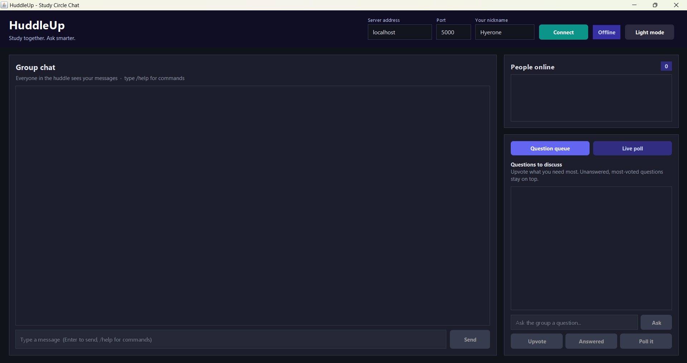

### Group chat
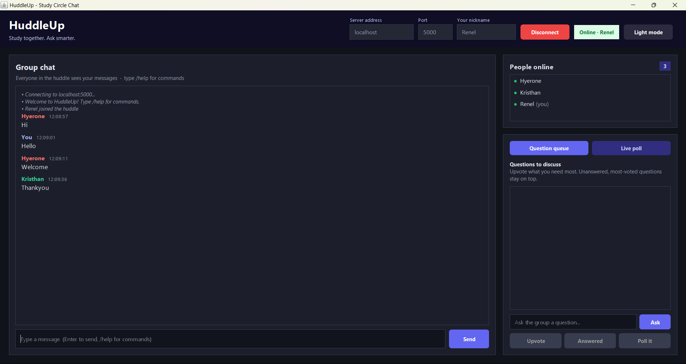

### Question Queue (original feature 1)
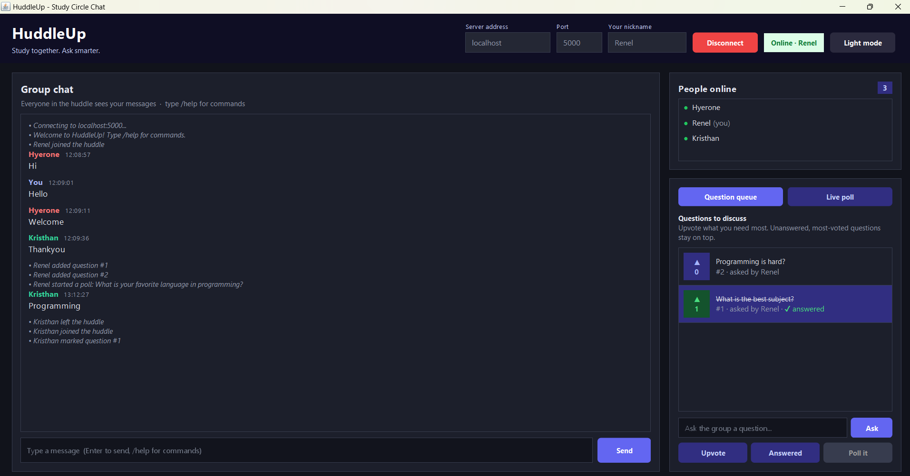

### Live Poll (original feature 2)
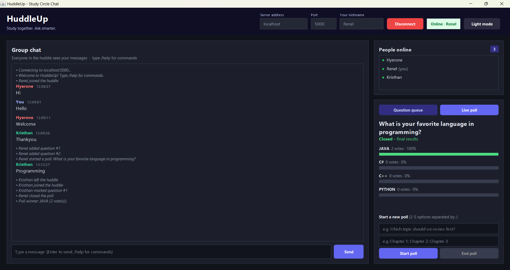

### Error handling (server unavailable)
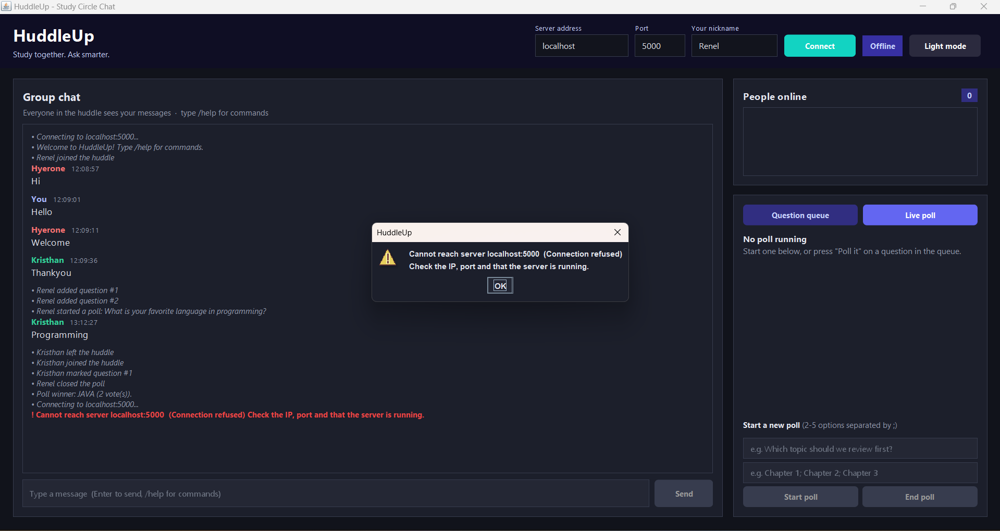

### Three clients, two computers
Server console on Computer A, showing clients joining from `127.0.0.1` and from Computer B (`192.168.100.145`):

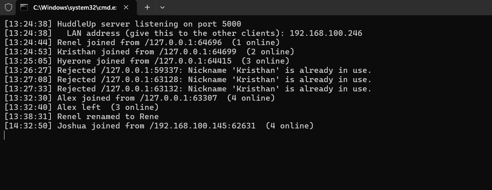

Client on Computer B connected to `192.168.100.246`:

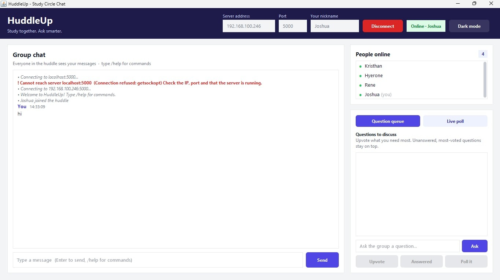

### Duplicate nickname
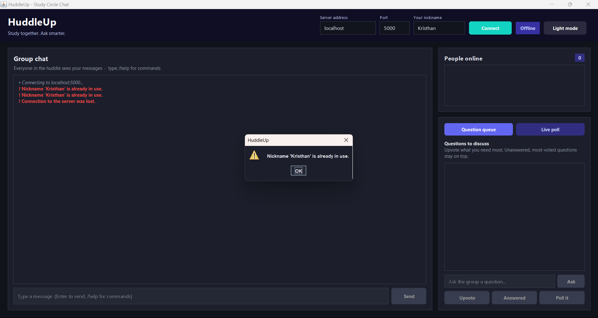

### Blank message
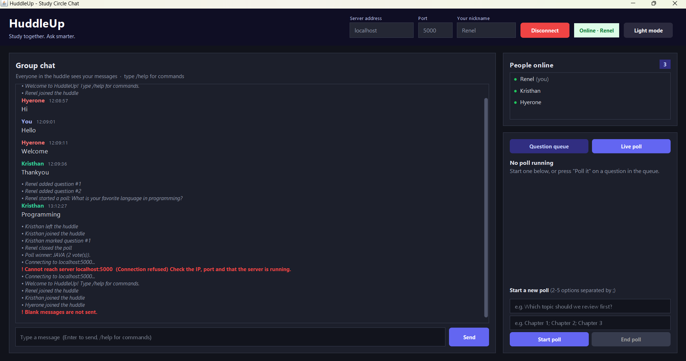

### Invalid host or port
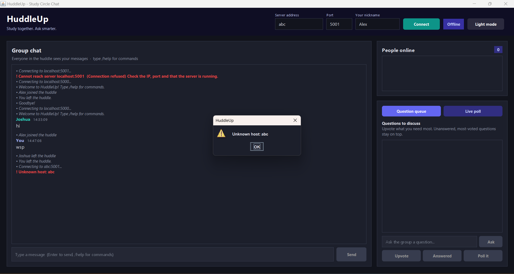

### Blank IP and bad port
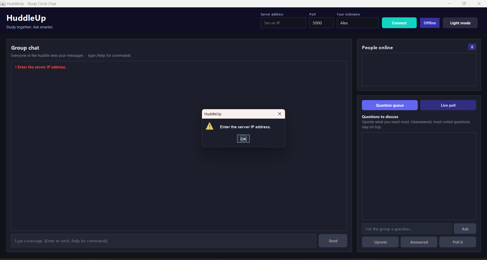

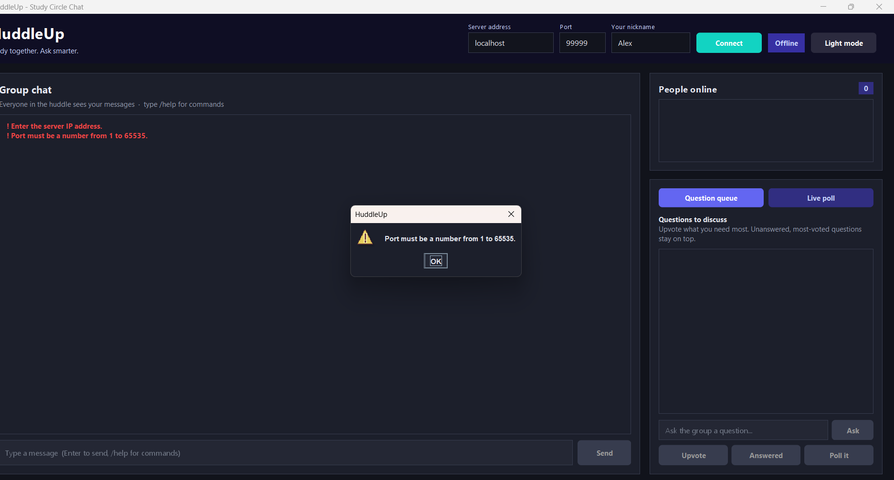

### User left and chat continues


### Chat continues after a user leaves
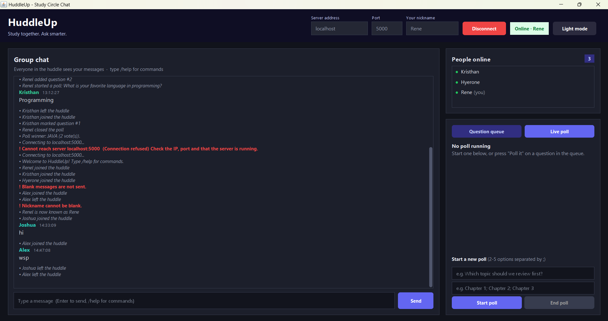

### Rename
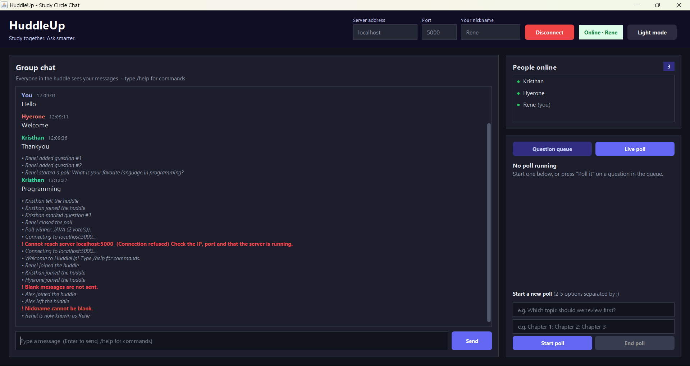

### Clean exit
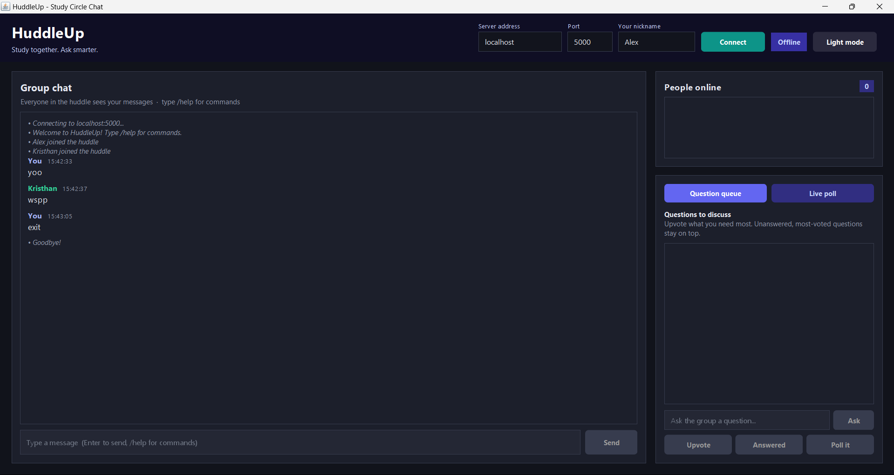

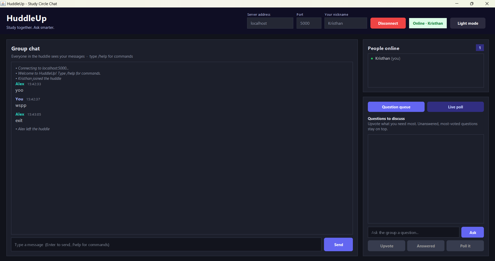

## 11. Contribution Log

| Date | Member (GitHub) | Task | Commit link |
|---|---|---|---|
| 2026-11-23 | Lucendo (@hyerone1) | Server: accept loop, thread per client, protocol | [commit](https://github.com/hyerone1/ITAS-2B-SD-Lucendo-Galos/commit/32b5385) |
| 2026-11-23 | Galos (@eryllegalos15-glitch) | Client: Swing window, connect, Question Queue and Poll panels | [commit](https://github.com/hyerone1/ITAS-2B-SD-Lucendo-Galos/commit/6b0c91b) |


## 12. Credits and AI Assistance

- Built with the standard Java library only (`java.net`, `java.io`, `javax.swing`, `java.util.concurrent`).
- AI assistance: Claude (Anthropic) was used to help design and review parts of the code and to help organize this README. Both members read and tested.
